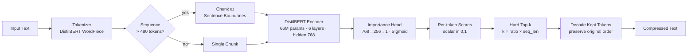
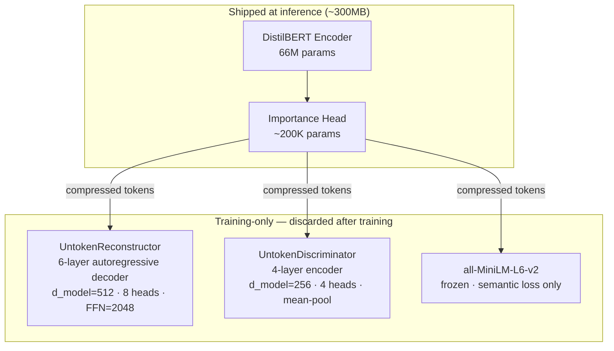
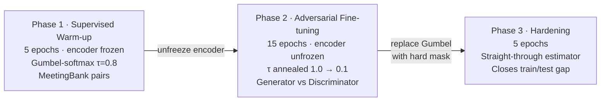
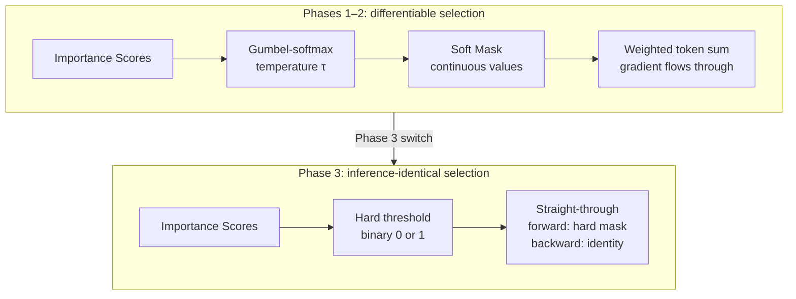

# UNTOKEN Architecture

## Overview

UNTOKEN is a token compression system that reduces prompt length by ~70% while preserving semantic content. It operates as a learned token selector: given a sequence of N tokens, it returns a subsequence of approximately 0.3N tokens ranked by contextual importance.

The shipped artifact is a single 300MB model (`UntokenCompressor`). The reconstructor and discriminator are training-only components and are discarded at inference.

---

## System Diagrams

### Inference Pipeline



### Training Architecture



### Three-Phase Training Flow



### Token Selection: Soft → Hard



---

## UntokenCompressor

The compressor consists of two submodules: a frozen or fine-tuned DistilBERT encoder and a learned importance head.

**Encoder**

DistilBERT-base-uncased (66M parameters, 6 transformer layers, hidden dim 768). It produces contextual token representations that encode both local syntax and global discourse structure. The encoder is frozen during Phase 1 and fine-tuned in Phases 2–3.

**Importance Head**

A lightweight 2-layer MLP applied per token position:

```
Linear(768 → 256) → GELU → Dropout(0.1) → Linear(256 → 1) → Sigmoid
```

The head outputs a scalar importance score in (0, 1) for each non-special token. Weights are Xavier-uniform initialized. Special tokens ([CLS], [SEP], [PAD]) are masked to zero before selection.

**Token Selection**

At inference, the top-k scores are selected via hard top-k, where k = ⌊ratio × seq_len⌋. The selected token ids are decoded directly, preserving original wordpiece order. For sequences exceeding 480 tokens, the input is chunked at sentence boundaries and each chunk is independently compressed.

---

## Training Architecture

### UntokenReconstructor

A 6-layer autoregressive Transformer decoder (d_model=512, 8 heads, FFN dim 2048, pre-norm). It takes the compressed token sequence as input and reconstructs the original sequence. Tied input/output embeddings. The reconstructor provides the reconstruction loss signal and is discarded post-training.

### UntokenDiscriminator

A 4-layer Transformer encoder (d_model=256, 4 heads) with mean-pool classification head. It learns to distinguish compressed sequences from naturally occurring text. Its adversarial signal pushes the compressor to produce outputs that appear fluent rather than token-salad.

---

## Training Procedure

Training proceeds in three sequential phases:

**Phase 1 — Supervised Warm-up (5 epochs)**

The encoder is frozen. Only the importance head and reconstructor are trained. The compressor learns token selection using supervision from (original, human-compressed) pairs from MeetingBank. Reconstruction loss drives the compressor to retain tokens necessary for recovering the original. Gumbel-softmax with temperature τ = 0.8 provides differentiable discrete selection.

Loss: L = L_recon + 0.3·L_ratio + 0.05·L_gating + 0.5·L_supervised

**Phase 2 — Adversarial Fine-tuning (15 epochs)**

The encoder is unfrozen. The full generator (compressor + reconstructor) is trained against the discriminator. Temperature is annealed from 1.0 to 0.1 over the phase to progressively sharpen selection decisions. The discriminator is trained on CNN/DailyMail highlights as real text and compressed outputs as fake.

Loss (generator): L = L_recon + 0.1·L_adv + 0.3·L_ratio + 0.05·L_gating + 0.5·L_semantic

Loss (discriminator): L = 0.5·(L_real + L_fake) with label smoothing (real=0.9, fake=0.1)

Semantic loss (all-MiniLM-L6-v2 cosine similarity) is computed every 10 steps due to inference cost.

**Phase 3 — Hardening (5 epochs)**

Gumbel-softmax is replaced with a straight-through estimator over hard binary masks. This trains the model under the exact discrete selection it will use at inference, closing the train/test gap introduced by soft relaxations.

Loss: L = L_recon + 0.3·L_ratio

---

## Training Data (v1)

| Dataset | Role | Size used | Domain |
|---------|------|-----------|--------|
| MeetingBank | Phase 1 supervised pairs | ~2,800 meetings | Corporate and academic meeting transcripts |
| CNN/DailyMail | Discriminator real text | ~50K article highlights | News |

**Total training tokens:** approximately 15–20M tokens across all phases. This is small by modern NLP standards. GPT-2 was trained on 40B tokens; LLaMA-3 on 15T. UNTOKEN v1 is several orders of magnitude below what would produce a general-purpose compressor.

**Known limitation at this scale:** The v1 model exhibits positional bias — it tends to assign higher importance to tokens early in the sequence rather than to semantically critical tokens distributed across the full context. This is a training data quantity and diversity problem, not an architectural one. At ratio=0.4, the model produces more coherent output than at 0.3, as the relaxed constraint reduces hard selection errors.

---

## Scaling Expectations

The architecture is designed to scale. The importance head is intentionally lightweight (~200K parameters) — the DistilBERT encoder already has sufficient representational capacity. All gains from scaling come from data, not model size.

### Data Quantity

| Training tokens | Expected behavior |
|----------------|-------------------|
| 15–20M (v1) | Positional bias, function-word preference, works best at ratio ≥ 0.4 |
| 200M–500M | Positional bias reduced, content-word preference emerges, generalizes across short inputs |
| 1B–5B | Reliable importance scoring across domains, robust at ratio=0.3 |
| 10B+ | Near-human level importance judgment, handles complex nested discourse |

### Domain Diversity

The discriminator quality is the primary bottleneck for generalization. Training it on a diverse real-text corpus directly improves the compressor's ability to produce fluent outputs across domains. Recommended additions for a v2 discriminator:

| Source | Why |
|--------|-----|
| The Pile (diverse web text) | Broad register and topic coverage |
| PubMed abstracts | Scientific and technical vocabulary |
| GitHub READMEs and code comments | Instruction-following and technical context |
| Legal contracts (CUAD) | Dense, precise language with high compression value |
| DailyDialog / conversational data | Complements MeetingBank, covers casual register |
| Wikipedia | Factual prose, well-structured paragraphs |

### Phase 2 Training Duration

Temperature annealing over 15 epochs is insufficient for the GAN to fully converge at small data scale. At larger scale, 30–50 adversarial epochs allow the discriminator to develop a stronger gradient signal, which forces the compressor to select semantically coherent subsets rather than high-frequency tokens. The three-phase structure remains unchanged — only epoch counts scale.

---

## Loss Functions

| Loss | Description |
|------|-------------|
| L_recon | Cross-entropy on full-sequence reconstruction from compressed input |
| L_supervised | Binary cross-entropy between predicted importance and human-labeled keep/drop |
| L_semantic | 1 − cosine similarity of all-MiniLM-L6-v2 embeddings of original vs compressed |
| L_adv | Generator loss: BCE toward real label for discriminator outputs on compressed sequences |
| L_ratio | \|mean(keep_probs) − target_ratio\|, clamped to [0.1, 0.6] to prevent collapse |
| L_gating | Per-token entropy of keep probabilities; encourages decisive binary decisions |

---

## Key Design Decisions

**Gumbel-softmax then straight-through.** Phases 1–2 use soft token selection to allow gradient flow through the discrete selection step. Phase 3 hardens this with straight-through estimation, which passes gradients as if the hard mask were identity while using the actual binary output in the forward pass.

**keep_probs clamping to [0.1, 0.6].** Prevents two failure modes: the compressor keeping everything (ratio → 1) or keeping nothing (ratio → 0). This bound is applied only in L_ratio and L_gating, not in the forward pass itself.

**Encoder frozen in Phase 1.** Freezing prevents the encoder from overfitting to MeetingBank structure before the adversarial signal can provide diversity. DDP requires find_unused_parameters=True during this phase.

**Discriminator real text.** CNN/DailyMail news highlights are used as real text for the discriminator. This is domain-diverse relative to MeetingBank and prevents the discriminator from learning domain-specific artifacts rather than fluency.

---

## Inference

```python
from untoken import Untoken

ut = Untoken("pacifio/untoken-v1")
compressed = ut.compress(text, ratio=0.3)
compressed, stats = ut.compress(text, ratio=0.3, return_stats=True)
```

The `ratio` parameter controls the fraction of tokens retained and can be adjusted at inference without retraining. Lower ratios increase compression aggressiveness at the cost of semantic fidelity.

---

## Evaluation (CNN/DailyMail, n=200, ratio=0.3)

| Method | Cosine Sim | ROUGE-L | Compression Ratio |
|--------|-----------|---------|-------------------|
| UNTOKEN | 0.878 | 0.459 | 0.304 |
| Random drop | 0.723 | 0.429 | 0.303 |
| Stopword removal | 0.933 | 0.824 | 0.761 |

UNTOKEN achieves +15.5pp cosine similarity over random drop at equivalent compression ratio. Stopword removal retains 76% of tokens and is not a comparable operating point.
